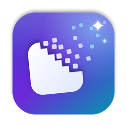
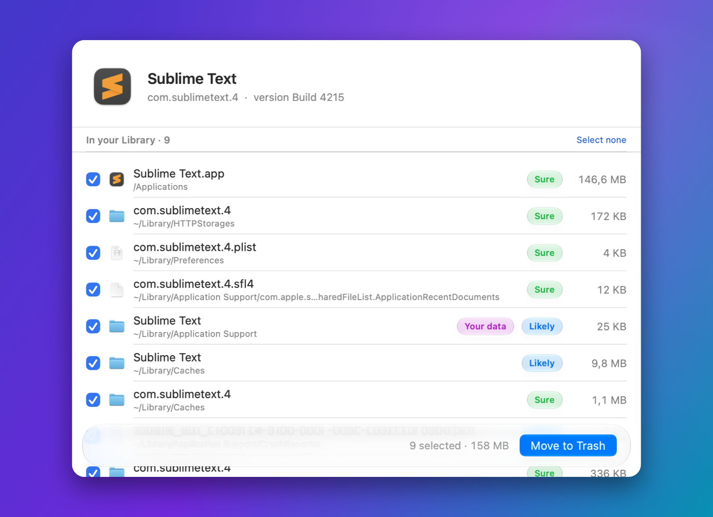
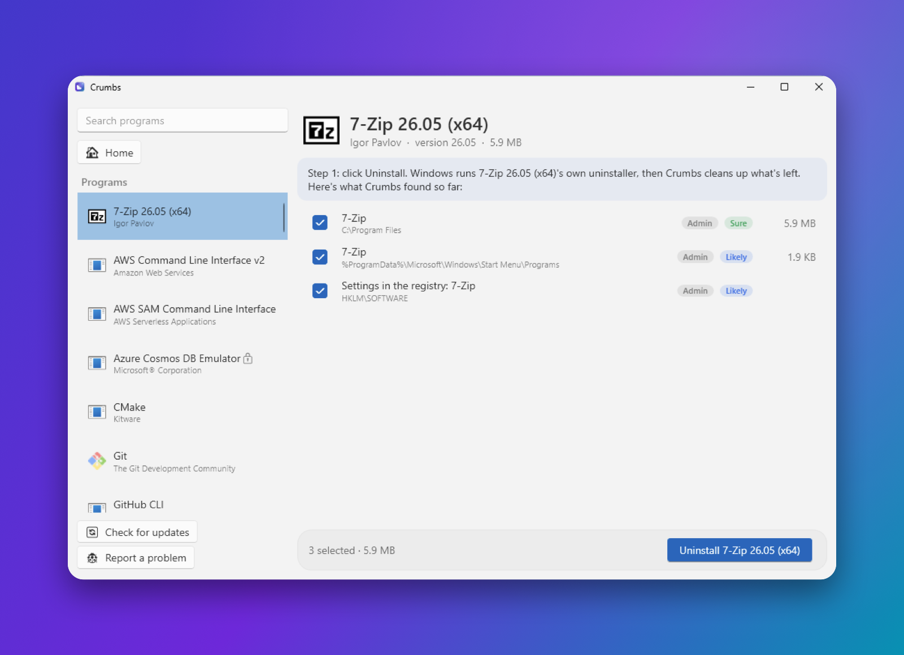

<p align="center">
  
</p>

<h1 align="center">Crumbs</h1>

<p align="center">
  <b>Uninstall apps. Completely.</b><br>
  For Mac and Windows. Free. Simple. Safe.
</p>

<p align="center">
  <a href="https://github.com/thehydracipher/crumbs/releases/latest"></a>
</p>

<p align="center">
  
  
  
  
  <a href="https://github.com/thehydracipher/crumbs/actions/workflows/tests.yml"></a>
  <a href="https://github.com/thehydracipher/crumbs/actions/workflows/windows.yml"></a>
</p>

<p align="center">
  
  
</p>

---

## What is Crumbs?

When you delete an app, it leaves things behind.

Settings. Caches. Logs. Old files you never see.

They take up space. They pile up over time.

**Crumbs finds them all. You choose what goes.**

That's it.

---

## Why you'll love it

🧹 **Removes everything.**
The app, and every file it hid around your computer.

👀 **You stay in control.**
See every file and its size before anything moves.

🟢 **Clear labels.**
Each file says *Sure*, *Likely* or *Possible*.
If Crumbs isn't sure, it never ticks it for you.

↩️ **Changed your mind?**
One click: **Undo**. Everything goes back.

🔒 **Safe by design.**
It never touches your system, Apple's or Microsoft's own apps, or your personal folders.

⚡ **Fast.**
Results appear in a blink.

✨ **Looks at home.**
Liquid Glass on the new macOS. The Fluent look on Windows 11.

🔄 **Always up to date.**
Crumbs checks for new versions. Updating is one click.

💸 **Free. For good.**
No ads. No account. No tracking.

---

## Get started on a Mac (2 minutes)

**1. Download** **Crumbs-x.y.zip** from the [download page](https://github.com/thehydracipher/crumbs/releases/latest).

**2. Install.** Double-click the zip. Drag **Crumbs** into **Applications**.

**3. Open it the first time.** macOS checks with you once, because Crumbs isn't from the App Store.
- Open Crumbs. Click **Done**.
- Open **System Settings → Privacy & Security**.
- Scroll down. Click **Open Anyway**.

**4. Turn on Full Disk Access.** Crumbs shows a button for it. Click it, then turn on **Crumbs**.
Like every Mac cleaner, Crumbs needs your permission to see protected folders. It's your choice.

## Get started on Windows (2 minutes)

**1. Download** **Windows-Crumbs-x.y-x64.zip** from the [download page](https://github.com/thehydracipher/crumbs/releases/latest).
(Have an ARM PC, like a Surface with Snapdragon? Take the **arm64** one.)

**2. Unzip it.** Right-click the zip → **Extract All**. Put **Crumbs.exe** wherever you like.

**3. Open it the first time.** Windows may say *"Windows protected your PC"*, because Crumbs is new.
- Click **More info**.
- Click **Run anyway**.

That's it. Nothing to install.

---

## How to use it

**On a Mac**
1. **Pick an app** from the list. Or drag an app onto the window.
2. **Look** at what Crumbs found.
3. **Click Move to Trash.** Done. ✨

**On Windows**
1. **Pick a program** from the list.
2. **Click Uninstall.** The program's own uninstaller runs first, the proper Windows way.
3. **Click Clean up** to remove what it left behind. Done. ✨

Everything goes to the Trash or Recycle Bin first, and registry settings are backed up.
Nothing is gone for good until you empty it.

### Also inside (Mac)

- **Orphaned Files.** Finds leftovers from apps you deleted long ago.
- **Deleted an app the normal way?** Crumbs notices, and shows you what it left behind.
- **Old installers.** Finds the setup files still sitting in your Downloads.
- **Protect an app.** Right-click it and choose *Protect from Removal*.

---

## Questions

**How do I completely uninstall an app on a Mac?**
Open Crumbs. Pick the app. Click **Move to Trash**.
Crumbs removes the app and the hidden files it left around your Mac.

**How do I completely uninstall a program on Windows?**
Open Crumbs. Pick the program. Click **Uninstall**, then **Clean up**.
Crumbs runs the program's own uninstaller, then removes the folders, shortcuts and
registry entries it left behind.

**How do I free up space on my computer?**
Remove the apps you don't use with Crumbs. It shows how much space each one takes.

**Is Crumbs really free?**
Yes. Free forever. It's open source, so anyone can check the code.

**Is it safe?**
Yes. Everything goes to the Trash or Recycle Bin first, and you can **Undo**.
Crumbs never touches your system, Apple's or Microsoft's own apps, or your personal folders.
It checks every item again, right before it moves it.

**Why does my computer warn me the first time?**
Crumbs is made by an independent developer, not sold through Apple or Microsoft.
On a Mac, click **Open Anyway** once. On Windows, click **More info → Run anyway** once.

**Why does the Mac version need Full Disk Access?**
Apps leave files in places macOS protects. Without access, Crumbs can't see all of them,
and can't **Undo**. You stay in charge: you can turn it off anytime in System Settings.

**Does Crumbs collect my data?**
No. It only goes online to check for a new version, and it sends nothing about you.

**How do I update Crumbs?**
Crumbs tells you when a new version is ready. Click **Update Now**.

**Is it like AppCleaner, CleanMyMac or Revo Uninstaller?**
It does the same job as AppCleaner and the uninstall part of Revo, for free, and open source.
CleanMyMac is a paid all-in-one cleaner. Crumbs does one thing, really well.

---

## Crumbs vs AppCleaner (Mac)

|  | **Crumbs** | AppCleaner |
|---|:---:|:---:|
| Free | ✅ | ✅ |
| Open source | ✅ | ❌ |
| Removes an app and its hidden files | ✅ | ✅ |
| Undo | ✅ | ✅ |
| Warns before removing your personal data | ✅ | ✅ |
| Notices when you delete an app in Finder | ✅ | ✅ |
| Updates itself | ✅ | ✅ |
| Shows how sure it is about each file | ✅ | ❌ |
| Never ticks files it isn't sure about | ✅ | ❌ |
| Finds leftovers of apps you deleted long ago | ✅ | ❌ |
| Finds old installers in Downloads | ✅ | ❌ |
| Looks in macOS's hidden cache folders | ✅ | ❌ |
| Also on Windows | ✅ | ❌ |

---

## Found a problem? Have an idea?

In Crumbs, choose **Report a Problem** (Mac: in the **Help** menu. Windows: bottom left).
A short form opens on GitHub with your version already filled in.
Nothing is sent until you click **Submit**.

Or go straight to [Report a problem](https://github.com/thehydracipher/crumbs/issues/new?template=bug_report.yml)
· [Suggest an idea](https://github.com/thehydracipher/crumbs/issues/new?template=idea.yml)

---

<details>
<summary><b>For developers</b> (build, tests, how it works)</summary>

### Mac (Swift, SwiftUI)

```bash
./build.sh                 # this Mac only
./build.sh universal       # Apple silicon + Intel
zsh tests/run.sh           # 59 checks on fake files (no password, nothing real is touched)
```

Command line: `Crumbs --scan "App"`, `--trash "App"`, `--orphans`, `--check-update`.

### Windows (C#, WPF, .NET 10)

The code is in `windows/`. It's built and tested on a real Windows PC by GitHub Actions
for every change: a fake program with fake folders, shortcuts and registry entries
(safety rules, removal, Undo), then Crumbs is opened and a screenshot is taken.

```powershell
dotnet test windows/Tests
dotnet publish windows/App -c Release -r win-x64 --self-contained -p:PublishSingleFile=true
```

### How it finds files

- **Sure:** the app's own ID (exact match), its install folder, its own shortcuts and start-up entries,
  or names from the app's own signature.
- **Likely:** exactly the app's name (also inside the maker's folder); helpers inside the app; crash reports.
- **Possible:** near names (`Name 2`, `NameBeta`), shared helpers, installers in Downloads. Never ticked for you.

### Safety

- Never: the system, Apple's or Microsoft's apps, anything locked by the system, Keychains, iCloud Drive,
  Mail, Messages, your personal folders, folder links that lead elsewhere, or Crumbs itself.
- Every item is checked against a list of allowed places right before it moves.
- Mac system files move with one macOS password prompt into a folder only the system can touch; Undo
  checks a SHA-256 fingerprint first. Windows registry entries are exported to a backup before removal.

### Updates

Crumbs checks the latest GitHub release once a day (you can turn this off), downloads it, checks the
SHA-256 checksum GitHub publishes, then swaps itself and reopens.

</details>

---

<p align="center">
Crumbs is a free, open-source app uninstaller and cleaner for macOS and Windows.<br>
A simple alternative to AppCleaner, Pearcleaner, CleanMyMac, Revo Uninstaller and App Cleaner &amp; Uninstaller.<br>
<b>MIT License</b>
</p>
